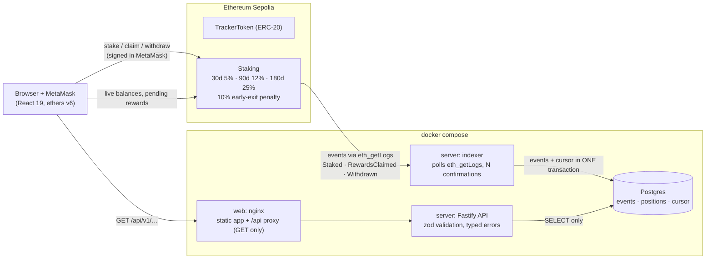

# DeFi Portfolio Tracker

[](https://github.com/goldentree831120-ui/defi-portfolio-tracker/actions/workflows/ci.yml)

A staking dApp on Ethereum Sepolia with a backend that indexes the contract's events into
Postgres. Users stake an ERC-20 token into time-locked tiers from a React frontend with
MetaMask. A Node indexer follows the chain (waiting for confirmations, restart-safe) and serves
wallet history and totals over a typed REST API. The whole stack runs with one Docker command,
and CI runs every layer, including a real browser, on every push.

**Testnet only.** No real funds are involved anywhere.

## Architecture



- **The frontend reads live state straight from the chain** through MetaMask (balances, pending
  rewards, lock timers), with every read pinned to one block so the numbers agree.
- **The indexer** turns contract events into history the chain can't answer cheaply ("all my
  positions, totals, every claim"). Its guarantees, each with a test:
  confirmation depth before indexing; **events and cursor committed in one transaction**, so
  a crash or restart never double-counts; idempotent inserts; one writer via row locks; halts
  on a reorg deeper than the confirmation depth instead of building on a dead branch;
  shrinks `eth_getLogs` ranges when an RPC provider caps them.
- **The API** is read-only. Every input is validated, and every error has the same
  `{error: {code, message, details}}` shape (`INVALID_ADDRESS`, `INVALID_QUERY`, …).

Details: [`server/README.md`](server/README.md), [`frontend/README.md`](frontend/README.md),
[`DOCKER.md`](DOCKER.md), [`e2e/README.md`](e2e/README.md).

## Sepolia deployment

| Contract | Address |
|---|---|
| Staking | [`0xd6AE22a0adE46C7eDbB92db28F6360089B94f513`](https://sepolia.etherscan.io/address/0xd6AE22a0adE46C7eDbB92db28F6360089B94f513) |
| TrackerToken (TRK) | [`0x2ffEC8C4Db1931b33985c26a8abFB0890C10e4a5`](https://sepolia.etherscan.io/address/0x2ffEC8C4Db1931b33985c26a8abFB0890C10e4a5) |

Deployed around block 11,962,251 from a deployer wallet used for nothing else. The reward pool
was funded with 200,000 TRK.

## Run it

```bash
# Everything, fully local, no keys or RPC provider: chain + contracts + Postgres + server + web
docker compose -f compose.yaml -f compose.local.yaml --env-file local.env up --build
./scripts/docker-smoke.sh            # 11 checks against the running stack; open http://localhost:8080

# Or develop the parts separately
cd server && npm ci && npm run dev:local    # embedded Postgres + Hardhat node + sample activity + API on :3001
cd frontend && npm ci && npm run dev        # http://localhost:5173 (Sepolia by default, see .env.example)
```

## Tests

| Layer | What | Count |
|---|---|---|
| Contracts | Hardhat: tiers, rewards accrual, early-exit penalty, invalid options, double withdrawal | 5 |
| Frontend unit | Vitest: amount parsing without float rounding, MetaMask/ethers/contract errors → readable messages (incl. OpenZeppelin custom errors from raw revert data), penalty and lock maths, config | 46 |
| Server | Vitest against **real Postgres and a real Hardhat chain**: indexer guarantees (crash mid-batch, restarts, two racing indexers, deep reorg, RPC range limits) + API (validation, typed errors, pagination, CORS) | 30 |
| End-to-end | Playwright: a real browser stakes through the UI; the position is then checked in the UI, on-chain and in the API; a rejected transaction changes nothing; early withdrawal records the penalty | 4 |
| Docker smoke | the running stack as a browser sees it: app, security headers, `/api`, read-only API, non-root server, no RPC key in the bundle | 11 |
| Mutation checks | bugs deliberately planted in the frontend logic and the indexer; the tests must fail for every one | 6 + 5 |

```bash
./scripts/test-all.sh                # frontend + server + e2e
./scripts/test-all.sh --mutations    # plus the mutation checks
(cd contracts && npm ci && npx hardhat test)
```

**CI** ([`.github/workflows/ci.yml`](.github/workflows/ci.yml)) runs all of this on every push
in six jobs: secrets and dependency audit, contracts, frontend, server, end-to-end, and Docker
(build the images, start the stack, smoke test).
[`.github/workflows/security.yml`](.github/workflows/security.yml) runs the contract security
review: the Foundry attack tests, and Slither, which fails on any finding not triaged.

## Security notes

- **No secrets in the frontend.** It needs no RPC key (reads and writes go through the user's
  wallet), and only the public chain id and contract address are built into the bundle. The
  Docker smoke test checks the served bundle for RPC provider keys.
- **Secrets only in git-ignored `.env` files.** `scripts/check-secrets.sh` runs in CI and fails
  on committed `.env` files, private keys or RPC URLs containing API keys (without printing them).
- **Dependencies:** CI fails on high or critical advisories in production dependencies. The
  first audit found real advisories in fastify 5.6.1 and ethers 6.15.0 (via `ws`); both were
  upgraded (fastify 5.12.7, ethers 6.17.0).
- **Least privilege at runtime:** the server image holds compiled JavaScript and production
  dependencies only and runs as a non-root user. nginx runs unprivileged, allows GET only on
  `/api` and sets security headers. Postgres isn't exposed outside the compose network.
- **Key incident, and how it was handled:** an early commit included a testnet private key in
  `contracts/.env.example`. It was treated as compromised: removed from every commit (history
  rewritten), contracts redeployed from a new wallet (the addresses above), and the secret scan
  added to CI so it can't happen again. The old contract and wallet are abandoned.
- **Security review of the contracts:** [`SECURITY.md`](SECURITY.md) and
  [`security/staking/`](security/staking/): threat model, Slither triage, and 15 Foundry attack
  tests run against the deployed contracts. Main finding (High): rewards are paid from the same
  token balance as principal, so rewards beyond the funded pool come out of other stakers'
  deposits; a large staker can drain everyone else. Also: an empty pool blocks withdrawing
  principal (High), and rewards keep accruing after the lock ends (Medium). Slither found none
  of these; the tests did. `StakingFixed.sol` fixes all three (separate principal and reward
  accounting, checked by a 1,000-run fuzz test). The Sepolia contract is the original and can't
  be patched, so the fixes would need a new deployment.

## Deployment

The Docker stack is deployment-ready. [`deploy/AWS.md`](deploy/AWS.md) is a step-by-step guide
for one EC2 server behind CloudFront (HTTPS without a domain; the server reachable only from
CloudFront; secrets only on the server), with the cost of every step. It isn't currently live:
the AWS account didn't pass identity verification.

## Repository layout

```
contracts/   Solidity (Hardhat): TrackerToken, Staking, tests, deploy script
security/    staking review: threat model, Slither triage, Foundry attack tests, fixed contract
frontend/    React + TypeScript + ethers v6 (Vite); Dockerfile + nginx config
server/      Node 24 + TypeScript: indexer + Fastify API, Postgres migrations, tests
e2e/         Playwright suite that starts the whole stack
deploy/      AWS guide, server .env template, EC2 bootstrap script
scripts/     test-all, docker-smoke, check-secrets, aws-up
backend/     v1: the original Java (Spring Boot + Web3j) backend, kept for reference
docs/        README-v1-java-backend.md: the v1 write-up
```

## From v1 to v2

v1 was a Java Spring Boot + Web3j service that polled the contract and cached snapshots
([write-up](docs/README-v1-java-backend.md)). v2 replaces snapshot polling with an **event
indexer**: it stores every event once, in order, with explicit guarantees about confirmations,
crashes and reorgs. It adds a typed API, Docker, a browser-level test suite and CI. The v1
code stays in `backend/` for comparison.

## Next steps

- Show indexed history in the UI (the API already serves it; the UI reads only live chain state today).
- Fix the two contract limitations above and redeploy.
- Go live: the AWS guide, or a static frontend on GitHub Pages (it needs no server).
